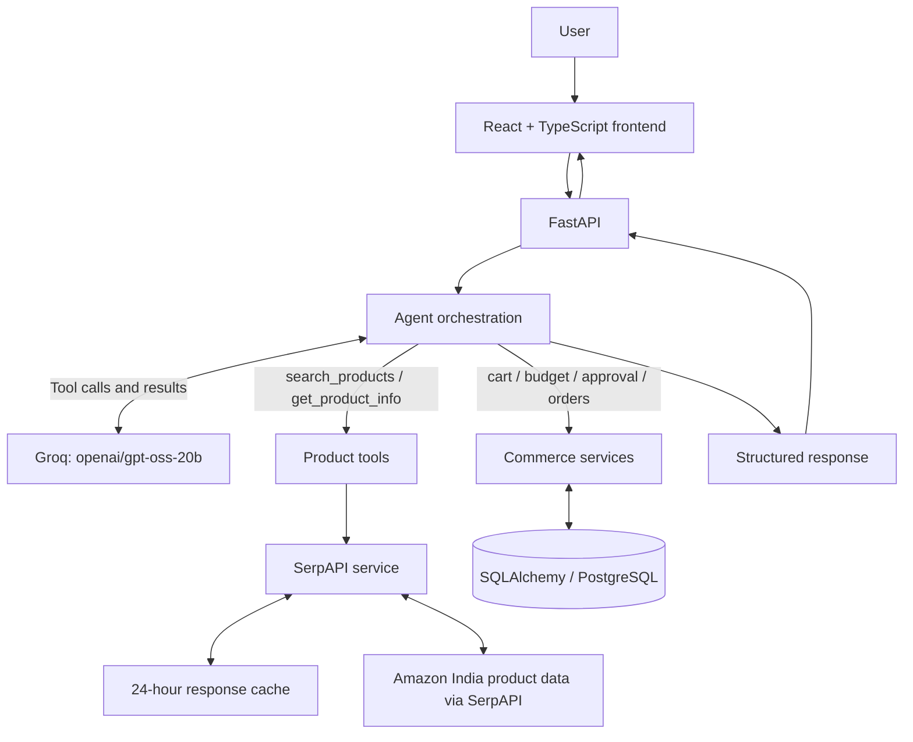

# Architecture and 3-Minute Demo

Agentic E-Commerce combines conversational AI with product discovery and a guided commerce workflow. This guide explains the current request path and provides a short demo plan.

## Architecture

## Product search flow

1. The user submits a natural-language shopping request in the frontend.
2. FastAPI passes the request to the Groq-powered agent.
3. The agent selects `search_products` when product discovery is needed.
4. The product tool calls the SerpAPI service for Amazon India results.
5. The service returns normalized product information and cache status.
6. The agent presents useful results through the chat experience.

## Product details flow

The user can explore a result by ASIN. The agent calls `get_product_info`, which retrieves available product details through SerpAPI. Details may include price, rating, images, specifications, and related items.

## Cart and checkout flow

1. Create a cart.
2. Add a selected product by ASIN.
3. View cart items and total.
4. Review budget context when available.
5. Ask the user for explicit approval before proceeding.
6. Continue through the backend order and payment services.

Commerce data is persisted through SQLAlchemy/PostgreSQL. SerpAPI responses use a separate 24-hour cache.

## Three-minute demo

**0:00–0:30 — Introduce the experience**

“Agentic E-Commerce turns natural-language shopping requests into a guided product discovery and checkout journey. Users can search, inspect products, manage a cart, and review budget context through a conversational interface.”

**0:30–1:10 — Search products**

Ask: “Find wireless headphones under ₹5,000.” Show the results and point out product titles, prices, ratings, images, and links. Explain that the backend uses SerpAPI for Amazon India data and caches responses for 24 hours.

**1:10–1:40 — Explore a product**

Select a result and retrieve details by ASIN. Show specifications and related products when available.

**1:40–2:20 — Cart and budget**

Add the selected product, open the cart, and show the item list and total. Demonstrate the budget review and explicit confirmation step.

**2:20–3:00 — Explain the architecture**

Walk through React + TypeScript, FastAPI, Groq tool calling, SerpAPI and its response cache, and database-backed commerce services. If demonstrating payment, use test credentials and show the backend verification flow.

## Strengths of the design

- Natural-language interface for product discovery.
- Clear separation between product retrieval and commerce operations.
- Reusable tool functions for agent-driven actions.
- Response caching to help reduce repeated product-data requests.
- Explicit user confirmation in the checkout approval flow.
- Persistent commerce data and backend payment handling.

## Future scope

- Product comparison views for shortlisted options.
- Personalized, explainable recommendations with budget-aware ranking.
- Structured agent traces for tool decisions, response times, cache hits, and cost.
- Automated evaluation for search relevance, tool selection, and checkout guardrails.
- Query-keyed JSON snapshots to support local debugging and repeatable demos.
- Containerized deployment and continuous integration checks.
