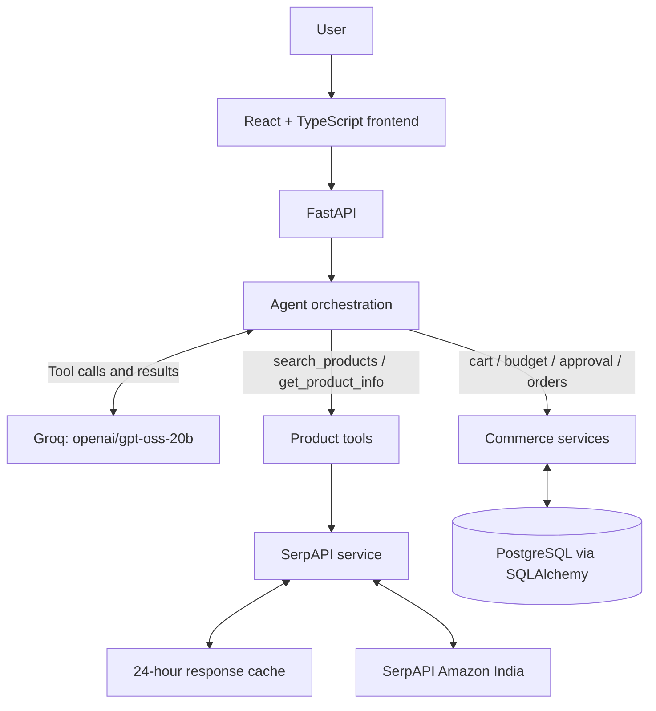

# Architecture and 3-Minute Demo

This document reflects the current code. SerpAPI response caching is separate from PostgreSQL persistence for cart and order workflows.

## Architecture

## Product search path

1. The frontend sends a chat message to FastAPI.
2. The Groq agent selects search_products when discovery is needed.
3. The tool calls the SerpAPI service for Amazon India results.
4. The service returns normalized product records and cache status.
5. The agent uses the result to answer the user.

## Product details path

The agent can call get_product_info with an ASIN. The service fetches product details through SerpAPI's Amazon product engine and returns available product fields and any related items provided by the response.

## Cache and persistence

- SerpAPI search and product-detail responses are cached for 24 hours.
- The cache is not a per-query JSON-file store.
- Cart, product records, orders, and audit operations still use SQLAlchemy/PostgreSQL.
- JSON-file caching and complete database removal are future refactoring work, not current behavior.

## Three-minute demo

**0:00–0:30 — Problem:** Introduce conversational shopping and the goal of moving from product search to a controlled cart-to-checkout flow.

**0:30–1:10 — Search:** Ask for a product with constraints, for example “Find wireless headphones under ₹5,000.” Show product cards and explain that the backend retrieves Amazon India data through SerpAPI with a 24-hour response cache.

**1:10–1:40 — Details:** Select a result and show details returned for its ASIN, including specifications and related items when available.

**1:40–2:20 — Cart:** Add the product, show the cart summary, and explain that cart persistence currently uses PostgreSQL. Review the budget and demonstrate the explicit approval step.

**2:20–3:00 — Architecture:** Explain the frontend, FastAPI, Groq tool calling, SerpAPI/cache, and database-backed commerce services. If showing payment, use test credentials and demonstrate server-side verification.

## Implementation facts

- Product provider: SerpAPI Amazon engine targeting amazon.in.
- LLM: Groq with openai/gpt-oss-20b as configured in the agent.
- Cache lifetime: 24 hours.
- Cart/order persistence: SQLAlchemy/PostgreSQL.
- JSON-per-search/ASIN caching and database removal are not implemented in the current code snapshot.
